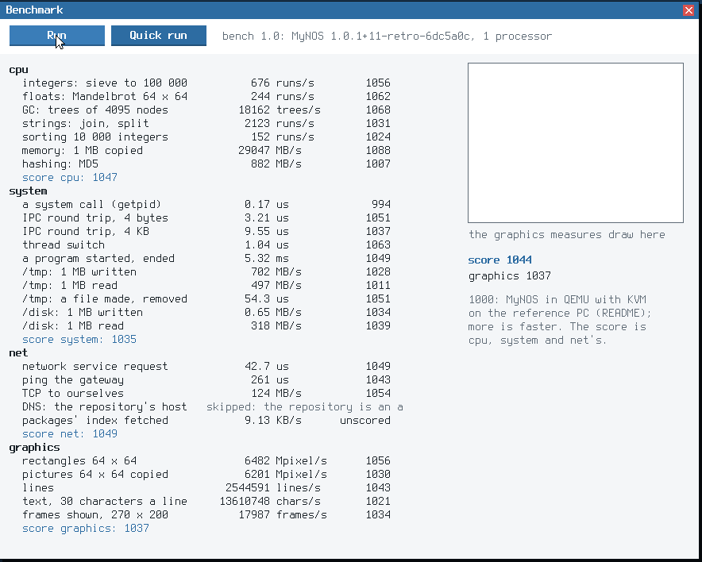

# bench

How fast this MyNOS is: the processor, the system, the network and, in
a window, the drawing.

```
mynos:/$ pkg install bench
mynos:/$ bench                      a window (in the graphical session)
mynos:/$ bench -t                   in the terminal: cpu, system, net
mynos:/$ bench -t cpu system        some groups only
mynos:/$ bench -t --quick           shorter, less precise
```

In the window, **Run** measures everything (about a minute), **Quick
run** the same in a third of the time; the graphics measures draw in the
box on the right while they run. Escape quits.



**The measures**

- *cpu*, OCaml's bytecode: a sieve of integers, Mandelbrot in floating
  point, the allocation of trees (the garbage collector), strings joined
  and split, sorting, 1 MB copied, MD5.
- *system*: a system call (getpid), an IPC round trip to another
  process (4 bytes and 4 KB), a switch between two threads, a program
  started and waited for, 1 MB written and read on `/tmp` (the RAM file
  system) and on `/disk` (FAT), a file made and removed.
- *net*: a request to the network service (netd), a ping to the
  gateway, TCP through netd to ourselves; the time of a DNS lookup and
  of the packages' index fetched over HTTPS, shown but not scored: they
  measure the Internet more than MyNOS.
- *graphics*, in a window only: rectangles filled, pictures copied,
  lines, text, and frames drawn and shown (the display service's part
  included).

**The scores.** Each measure is shown in its unit (operations a second,
MB/s, microseconds) and as a score: 1000 is MyNOS 1.0.1 in QEMU with
KVM on the reference PC, more is faster. A group's score is the
geometric mean of its measures'; the score is the geometric mean of
cpu's, system's and net's. Graphics, which needs a window, has its own,
apart. The reference: MyNOS 1.0.1 (i386) in QEMU 10.2 with KVM, 2 GB of
memory, on the PC MyNOS is developed on (x86-64, Linux), the mean of
three runs.

**The runs** are kept in `/disk/bench/history.json` (the last 50): each
measure shows its change since the last run (`+12%` faster, `-5%`
slower). `--no-save` keeps none.

**How it measures.** MyNOS's clock moves in ticks of 10 ms, so each
measure starts on a tick and runs for 0.3 s at least, three times; the
median is kept (once, 0.12 s, with `--quick`). The numbers vary by a few
per cent from one run to the next.

**The agent.** MyNOS's agent has a tool, `benchmark`: it runs `bench -t
--no-save` on the groups asked (cpu, system, net) and reads the result.
