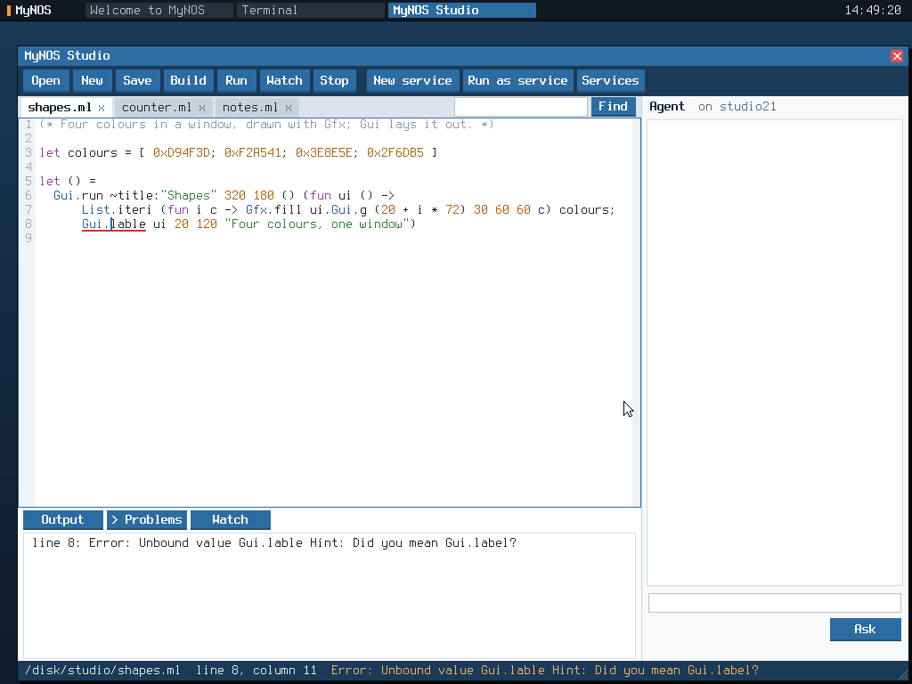
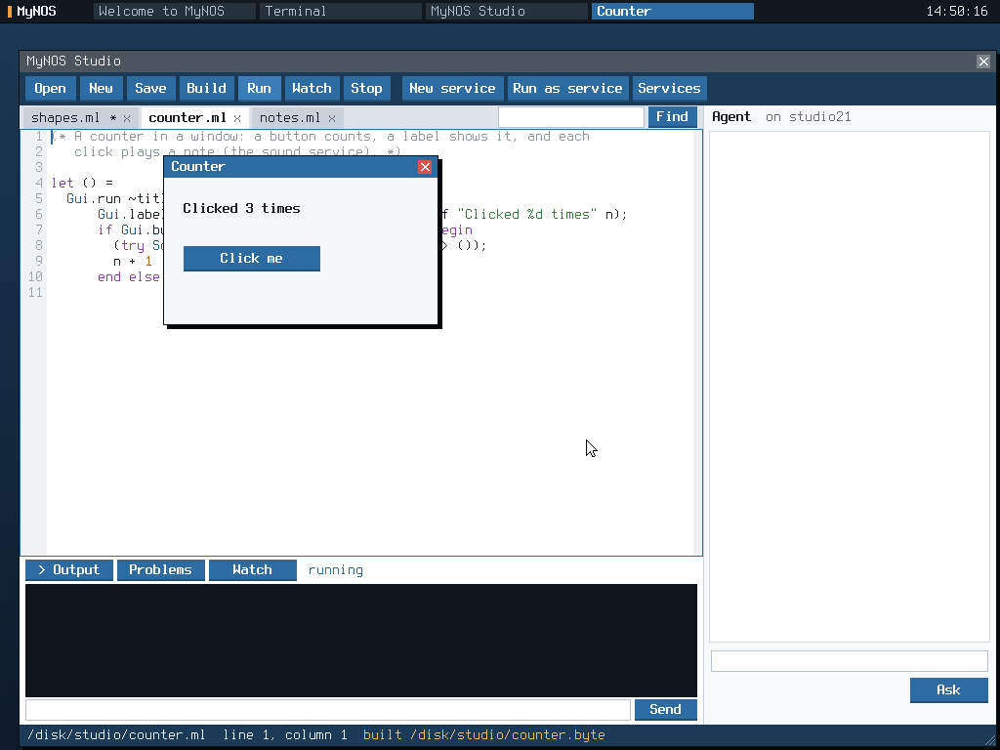
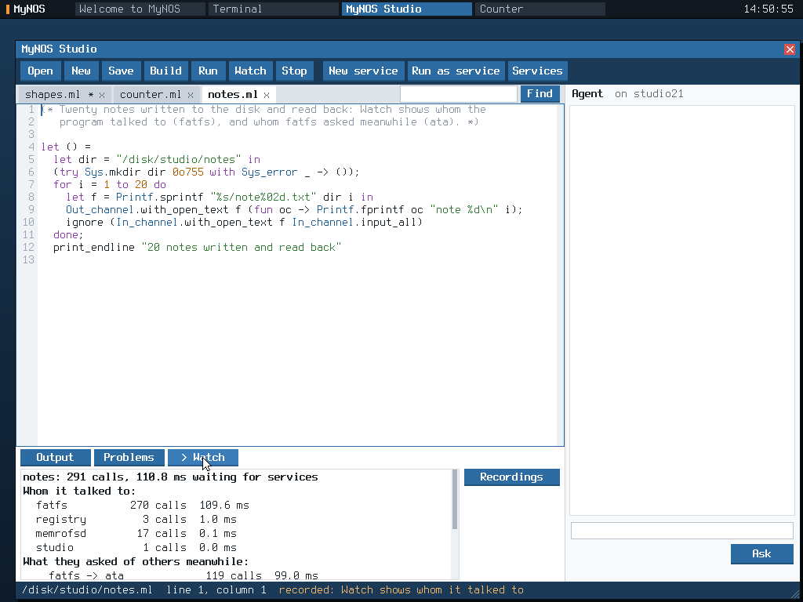
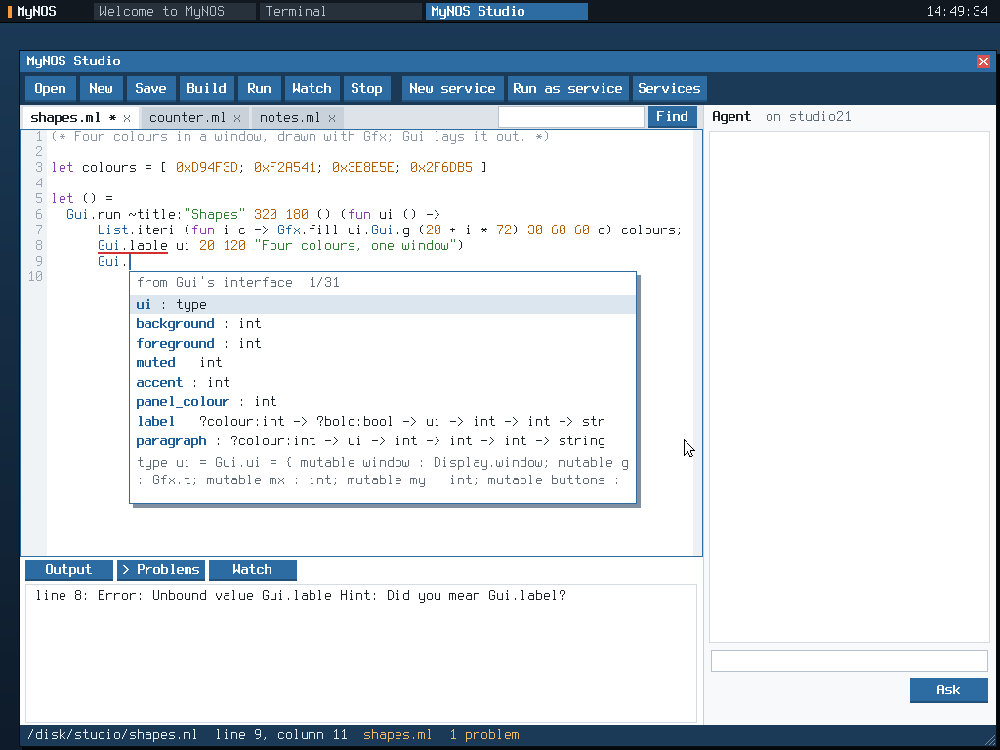
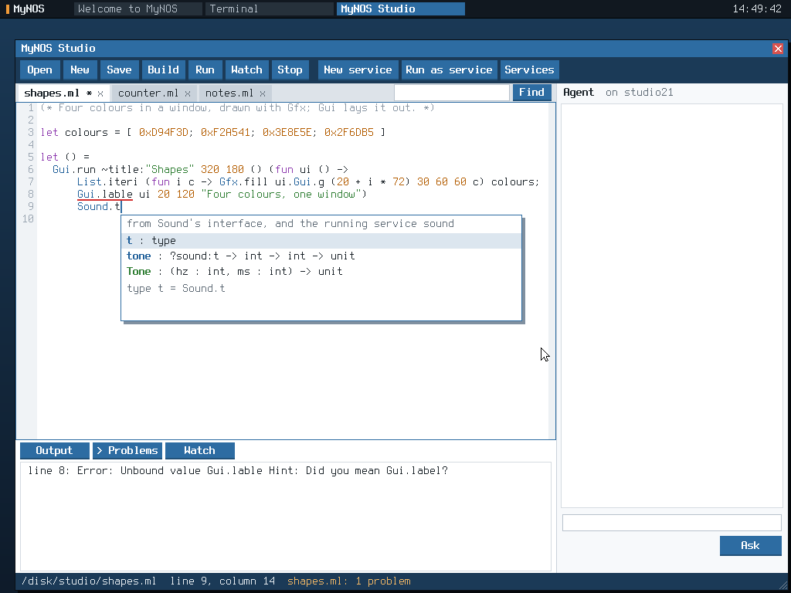
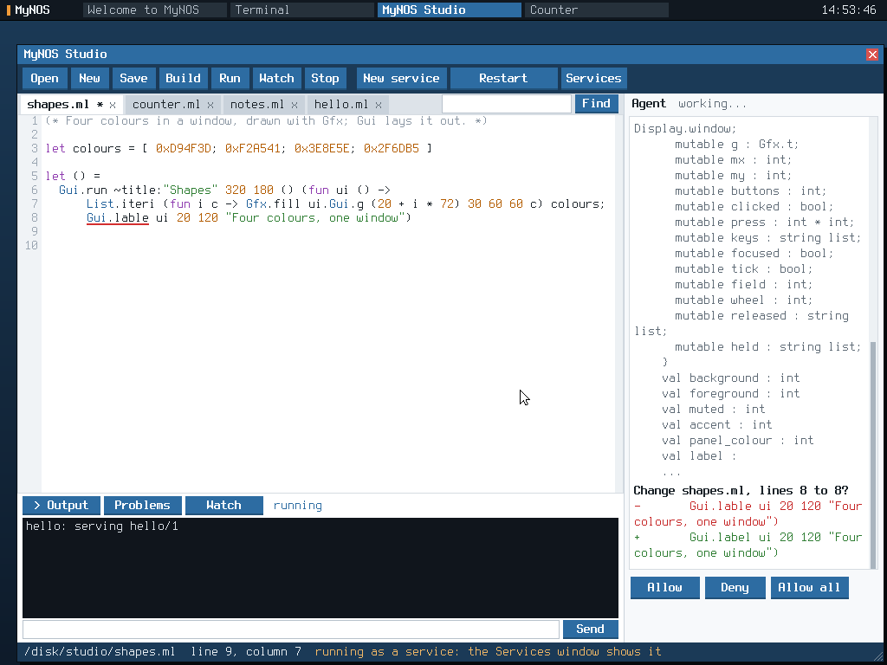
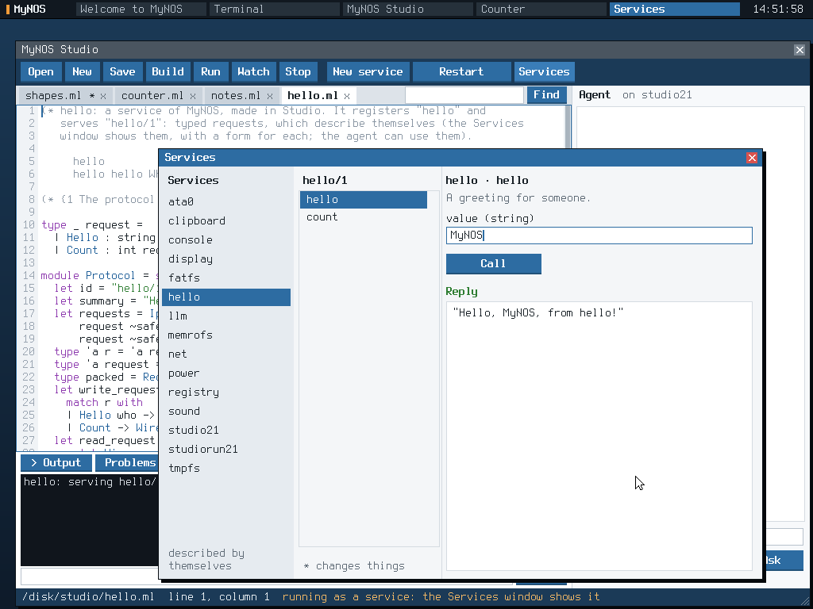

# MyNOS Studio

An editor for OCaml inside MyNOS, and a citizen of the system it
programs: it is a service itself, it builds with the compiler inside
MyNOS, it completes from the services that are running, it watches a
program with the event recorder.



```
mynos:/$ pkg install studio
mynos:/$ studio                     (or the menu's Applications)
mynos:/$ studio /disk/life.ml       (files to open)
```

Its files go in `/disk/studio/` (the first program, `hello.ml`, New,
New service, Open's folder); a path names any other place.

## The editor

Files in tabs, OCaml coloured, line numbers; the keys of an editor
(Shift with the arrows selects, Ctrl-C, Ctrl-X, Ctrl-V, Ctrl-Z, Ctrl-Y);
Ctrl-S saves, Ctrl-F finds, Ctrl-O opens. The window is resizable: a
double click on its title maximizes it.

## Build, Run, Watch

**Build** (Ctrl-B) compiles the file with the `ocamlc` inside MyNOS
(`mynos.cma`, and `unix`, `threads`, `str`... when the code names them):
its program goes beside it (`hello.byte`). The errors are underlined in
the text, their message in the status line when the cursor is on them,
and listed in **Problems** (a click goes there). Above: `Gui.lable`,
and the compiler's hint.

**Run** (Ctrl-R) builds, then starts the program with its console in
**Output**: Studio is that console (a service of its own, as a terminal
window is), so what the program prints comes there, and the line under
it answers its reads. **Stop** ends it. A program with a window opens
its window: here `counter.ml`, a window with a button.



**Watch** runs it under the event recorder. When it ends (or Stop),
**Watch** shows whom it talked to: its calls by service, how many and
how long, what those services asked of others meanwhile, the slowest
calls. **Recordings** replays the recording, step by step. Below, a
program that writes twenty notes to the disk: 270 calls to `fatfs`, and
the calls `fatfs` made meanwhile to `ata`, the disk's driver. The
microkernel's conversations, measured from the editor.



## Completion from the running system

Nothing to press: as you type a module's name and a dot (`Gui.`,
`List.`, `Sound.`), and then letters, a list offers what completes it.
Up, Down, Enter or Tab, Escape. It comes from two places:

- **the module's interface**, as the compiler inside MyNOS knows it: its
  values with their types, its types and their constructors, its
  exceptions and modules. Any module whose `.cmi` the compiler finds:
  MyNOS's library (`Gui`, `Gfx`, `Textarea`, `Ipc`...), OCaml's (`List`,
  `String`, `Hashtbl`...), `Graphics`, `Str`, and your own beside the
  file. Studio asks `ocamlc -i` once for each module, in the background
  (half a second; "reading its interface..." meanwhile).
- **the running service** whose protocol has that name (`Sound` is
  `sound/1`'s, `Display`, `Net`, `Fs`, a service of your own): its
  requests as the service describes itself now, the constructor, its
  typed arguments, its reply, its documentation, in green. A module of
  MyNOS's whose service is not running says so ("sound: not running").



After `Sound.t`: `tone`, a function of the module, and `Tone`, a
request of the sound service running now (green).



## The agent, and ide/1

Studio registers a service, `studio<pid>`, protocol `ide/1`: files,
read, replace, open, save, build, errors, goto, find. Its agent pane is
MyNOS's agent given that service: those requests are its tools. Ask it
to fix the error at the cursor, or to add a function: it reads the file,
proposes lines to replace (shown as lines removed and added, waiting for
Allow), builds, reads the errors. A Terminal, a script or the Services
window can use `ide/1` too. The agent needs a language model
(`/disk/llm.env`).



## A service of your own

**New service** asks a name, and writes `/disk/studio/NAME.ml`: a typed
service with two requests, its protocol describing itself. **Run as
service** builds it and starts it; the **Services** window shows it,
with a form for each request. After a change, **Restart** replaces it:
its clients find it again by name. From a Terminal: `NAME.byte hello
WHO`.



## The pictures

They are made by a script, not by hand: `tools/pkg-shots.sh studio` in
MyNOS's sources starts MyNOS, installs Studio, and follows
`packages/studio/shots.sh`, with the example files of
`packages/studio/shots/`.
